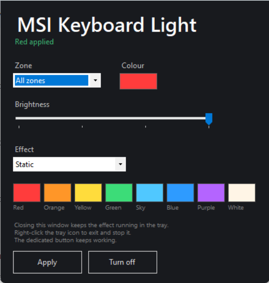

# MSI Keyboard Light

A tiny, dependency-free Windows app to control the backlight of MSI laptops with a
SteelSeries keyboard — the ones that expose the **MSI EPF USB** lighting controller
(`USB\VID_1770&PID_FF00`).

No installer. No background service. No registry changes. It talks to the keyboard's
HID controller directly and leaves nothing behind.



## Features

- **Zones** — all, left, middle, right (the controller's three lighting zones)
- **8 colours** — red, orange, yellow, green, sky, blue, purple, white
- **Brightness** — 0 (off) to 3 (max)
- **Effects** — Static, Breathing, Wave, Off
- **Tray behaviour** — closing the window keeps the effect running; `Exit` in the
  tray menu stops it
- Command-line mode for scripts and shortcuts

## Requirements

- Windows 10 or 11 (.NET Framework 4.x, included with the OS)
- An MSI laptop exposing `USB\VID_1770&PID_FF00`
- No administrator rights needed

If the controller isn't present the app simply reports *"Lighting controller not
found"* and does nothing else.

## Getting it

Download `MsiKeyboardLight.exe` from the [Releases](../../releases) page and run it.
The binary is unsigned, so the first launch may show *"Windows protected your PC"* —
choose **More info → Run anyway**.

Or build it yourself (below) — it takes about two seconds.

## Usage

| Control | Values |
|---|---|
| Zone | All zones / Left / Middle / Right |
| Colour | the 8 presets the controller supports |
| Brightness | 0 – 3 |
| Effect | Static / Breathing / Wave / Off |

Effects are generated by the app (the firmware has no native effect mode), so they
need it running. Closing the window hides it to the notification area and the
animation continues; right-click the tray icon → **Exit (stop effects)** to stop.
A static colour stays set after the app exits.

### Command line

```
MsiKeyboardLight.exe --preset 1-8 [--brightness 0-3]
MsiKeyboardLight.exe --off
```

## Known limitations

- **Preset colours only.** The firmware accepts the predefined-colour command and
  acknowledges, but ignores, raw RGB reports. Tested with and without the
  Engine-3 style `0x41 0x09` handshake, and with both `0x00` and `0xEC` terminators.
  A colour picker would therefore be a lie, so the app exposes the 8 presets.

- **MSI only.** The app is a thin client for one specific controller. On any other
  laptop there is no device to talk to. It will not add colour to a white-backlight
  keyboard — that is a hardware limit, not a software one.

- **Tested on** an MSI GE60 2PE (MS-16GF), keyboard firmware 2.2.x. Other MSI models
  with the same controller generally work, but report layouts differ between
  generations; if a colour has no effect on your model, it is a firmware difference.

## Protocol

Eight-byte HID feature reports, report ID 1:

| Report | Meaning |
|---|---|
| `1,2,66, region, colour, brightness, 0, 236` | preset colour |
| `1,2,65, mode, 0, 0, 0, 236` | mode (1 normal, 2 gaming) |

`region`: 1 left, 2 middle, 3 right · `colour`: 0 off, 1 red … 8 white ·
`brightness`: 0–3

The raw-RGB form (`1,2,64, region, r, g, b, 236`) is accepted but ignored by this
firmware generation.

Protocol knowledge came from [ErrorNoInternet/msi-klc](https://github.com/ErrorNoInternet/msi-klc)
(tested on the GE60 2PE) and [ed10vi/msi-steelseries-led](https://github.com/ed10vi/msi-steelseries-led)
(GE70 2PE). Thanks to both.

## Building

Everything is one C# file with no external packages:

```powershell
.\build.ps1
```

or directly:

```
csc /target:winexe /out:MsiKeyboardLight.exe ^
    /r:System.dll /r:System.Drawing.dll /r:System.Windows.Forms.dll ^
    src\MsiKeyboardLight.cs
```

`csc.exe` ships with .NET Framework, e.g.
`C:\Windows\Microsoft.NET\Framework64\v4.0.30319\csc.exe`.

## Disclaimer

Not affiliated with MSI or SteelSeries. The app writes reports to the keyboard
controller, exactly as MSI's own software does. It works on the machine it was
built for; use at your own risk, no warranty.

## License

MIT — see [LICENSE](LICENSE).
